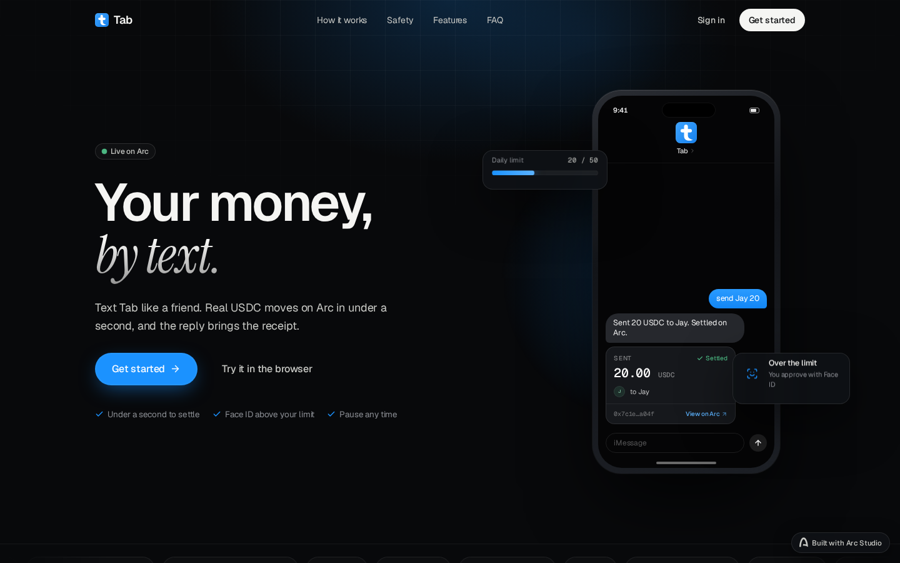
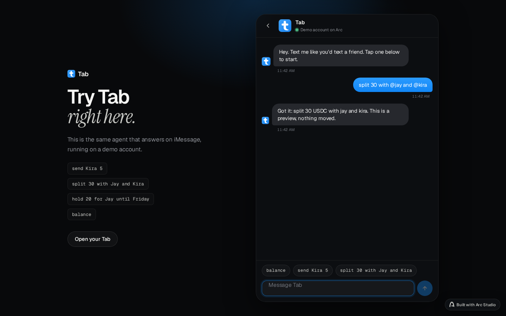
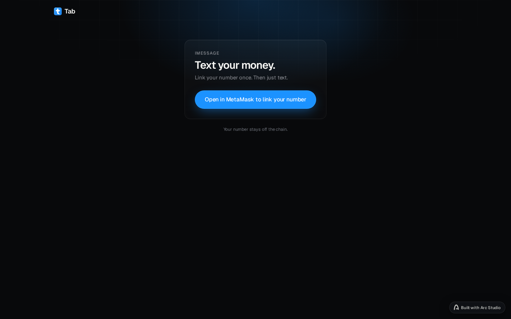
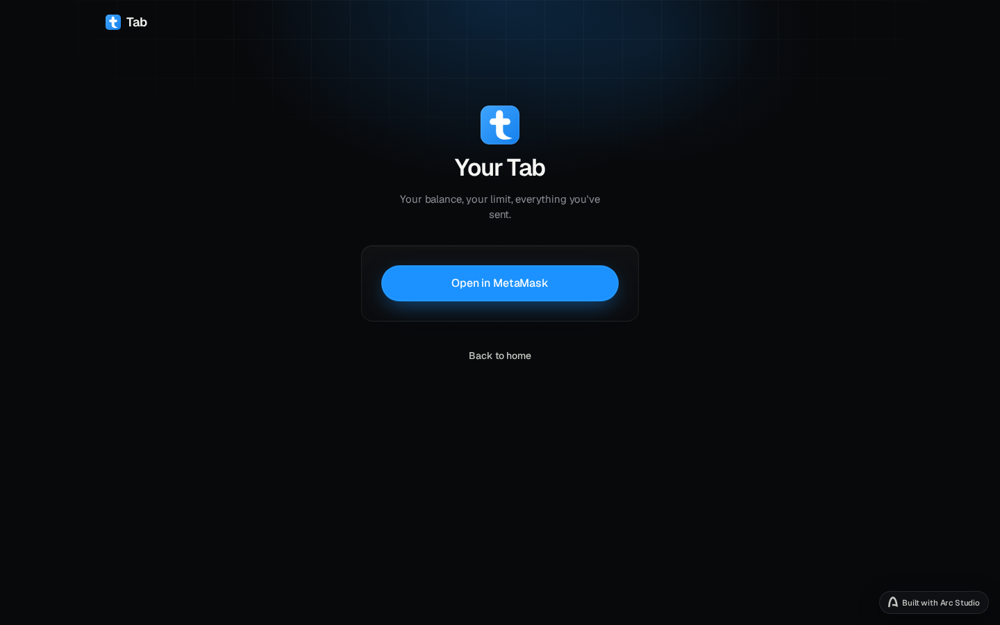
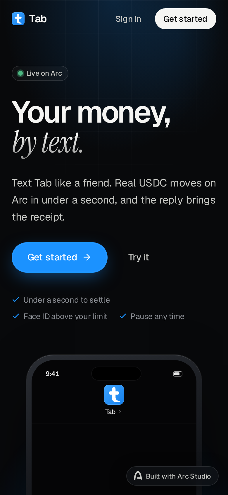
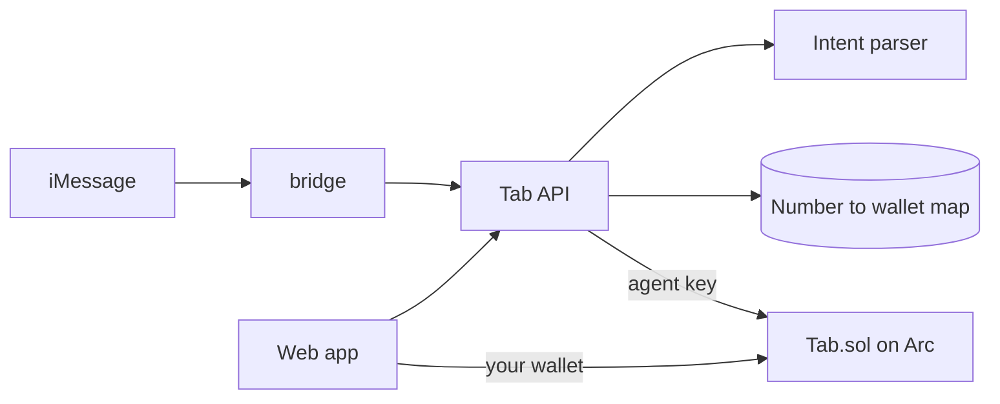

<div align="center">


# Tab

**Your money, by text.**
Text Tab like a friend and real USDC moves on Arc, with the receipt in the reply.

[**Live →**](https://tab-arc.vercel.app) &nbsp;·&nbsp; [Get started](https://tab-arc.vercel.app/join) &nbsp;·&nbsp; [Try it in the browser](https://tab-arc.vercel.app/try) &nbsp;·&nbsp; Arc mainnet

</div>

---

## What Tab is

Tab is a USDC wallet you run from iMessage. You link your number once, then text things like `send 5 to @kira` or `split 30 with @jay and @kira`. An agent reads the text, and one smart contract on Arc mainnet moves the money. Built with Arc Studio.

Three ideas shape the product:

1. **The text is the interface.** No app to open for everyday money. You send, split and hold by typing a sentence, and Tab replies with an explorer link.
2. **The agent has a leash, written in the contract.** It can only spend inside your daily limit (20 USDC by default). Anything above that comes back as a link you confirm in your own wallet.
3. **Your number never touches the chain.** The phone to wallet mapping lives off chain. Only wallet addresses appear on Arc.

---

## Product

### Join

Open **Get started**, connect MetaMask on Arc mainnet, pick a username and sign one message. Tab shows a short code. Text that code to the Tab line and the page moves you to **/me** by itself as soon as the text lands. In a phone browser with no wallet, the button reads **Open in MetaMask** and reopens the same page inside the MetaMask app.

### Text commands

| You text | What happens on Arc |
|---|---|
| `send 0.10 to @kira` | `send` moves USDC between Tab balances in one call |
| `send 5 to +1 555 0100` | `sendToClaim` locks it behind a claim link for someone not on Tab yet |
| `split 30 with @jay and @kira` | `createSplit`, each person gets a pay link for their share |
| `hold 20 for @jay until Friday` | `hold` escrows it, released by text or refundable after the deadline |
| `release <id>` | `release` pays out the hold |
| `balance` | reads your Tab balance |

Over your daily limit, Tab replies with a **/confirm** link instead and you sign that one yourself. Unknown usernames are refused with a "did you mean" reply, never guessed.

### Your Tab (/me)

Your **balance**, how much of today's **limit** is spent, **Deposit**, **Withdraw**, and everything you have sent. Deposit and withdraw are signed by you, never by the agent. Approve and deposit go out as one batch, so there is one prompt and no leftover allowance.

### Try it

**/try** is the same agent that answers on iMessage, running on a demo account. Nothing moves there, it shows what Tab understood.

---

## Screenshots

| | |
|---|---|
|  |  |
| Landing, live site | /try parsing a real split |
|  |  |
| Join, links your number | /me before a wallet is connected |

<p align="center"></p>

Captured from the live site by `scripts/readme_shots.py`.

---

## On mainnet

| | |
|---|---|
| Contract | [`0xd766C9Ed909A7EcAcfaf32c1f9DCC8Db8ed4A443`](https://explorer.arc.io/address/0xd766C9Ed909A7EcAcfaf32c1f9DCC8Db8ed4A443) on Arc mainnet (chain 5042) |
| USDC | `0x3600000000000000000000000000000000000000` (Arc predeploy) |
| First deposit | [`0x72a5…220f`](https://explorer.arc.io/tx/0x72a51d179db404f4385a4867b43c6da4fec432ceabc51bf3af561b3272a6220f), 0.20 USDC |
| First send by text | [`0xf750…d9a4`](https://explorer.arc.io/tx/0xf7504037cf6d815f37c2527bd699e5a4a783776b0083660d864d9931c06bd9a4), `send 0.10 to @kira`, emits `Sent` for 0.10 USDC |
| Arc Studio deploy | [`0x8c6b…a9`](https://explorer.testnet.arc.io/address/0x8c6ba8e3de84f347df7e6be49e982d27f488b5a9) on Arc testnet, runtime bytecode identical to mainnet |

---

## Architecture



| Folder | What it is | Stack |
|---|---|---|
| `src/` | Web app: landing, join, /me, /try, claim, split, confirm | React 18, Vite, Tailwind, wagmi, viem |
| `server/` | API: parses texts, guards them, relays to the contract | Bun, Express, viem |
| `bridge/` | iMessage line to the API and back | Node, Photon |
| `contracts/` | `Tab.sol` and its Foundry tests | Solidity 0.8.28, OpenZeppelin 5.1 |

### Modules

| File | Job |
|---|---|
| `contracts/Tab.sol` | Balances, daily limits, send, claim, split, hold, agent controls |
| `contracts/test/Tab.t.sol` | 47 Foundry tests |
| `server/index.ts` | HTTP routes, join flow, text command handling |
| `server/llm.ts` | Intent parser plus a deterministic gate on whatever the model returns |
| `server/chain.ts` | Contract reads and agent writes |
| `server/db.ts` | Off chain users, usernames, pending confirmations |
| `server/photon.ts` | Sends replies on the iMessage line |
| `bridge/imessage-bridge.mjs` | Pulls inbound texts, posts them to `/imessage`, sends the reply |
| `src/components/SignIn.tsx` | Wallet connect, with the MetaMask deep link on mobile |
| `src/components/JoinPage.tsx` | Join flow, waits for the code text and moves on by itself |

---

## Limits and safety

| Guard | Where | Rule |
|---|---|---|
| Daily limit | contract | Agent spends at most your limit per day, default 20 USDC. Over that returns a confirm link you sign yourself |
| Agent off switch, per user | contract | `setAgentDisabled(true)` blocks the agent from your balance |
| Agent pause, global | contract | Owner can pause every agent action at once |
| Agent rotation | contract | A new agent waits 2 days (`proposeAgent`, then `acceptAgent`) |
| Model output | server | The parser's result is checked against the text itself: one verb, one amount, known recipients, or it is refused |
| Inbound texts | server | `/imessage` requires a shared relay secret |

---

## Run it yourself

**Requires** Bun 1.1+, Foundry, a wallet on Arc, and a DeepSeek compatible API key for the parser.

```bash
bun install
forge install foundry-rs/forge-std --no-git   # into lib/
bun run contracts:test                         # 47 tests
```

Copy `.env.example` to `.env` and fill it in, then:

```bash
bun run server   # API on :3001
bun run dev      # web app on :5173, /api proxied to :3001
```

To deploy your own contract: `forge create contracts/Tab.sol:Tab --constructor-args 0x3600000000000000000000000000000000000000 <owner>`, then call `setAgent(<agent address>)` from the owner wallet and set `VITE_TAB_ADDRESS`.

---

## Quality

| | |
|---|---|
| Tests | 47 of 47 Foundry tests pass: deposits, withdrawals, limits, send, claim signatures and refunds, splits, holds, agent controls |
| Security | Review in `docs/security-review.md`, done in Arc Studio |
| Secrets | Agent key, relay secret, parser key and Photon credentials come from env only. `.env*` is gitignored |

---

## Roadmap

- [x] Contract live on Arc mainnet
- [x] Join by text, send, split, hold, claim links
- [x] Daily limit with confirm above it
- [ ] Set your daily limit from /me
- [ ] WalletConnect, so any mobile wallet can join
- [ ] Independent audit before real volume

---

<div align="center">
<sub>Tab runs on Arc mainnet. Early software holding real USDC, so keep balances small.</sub>
</div>
